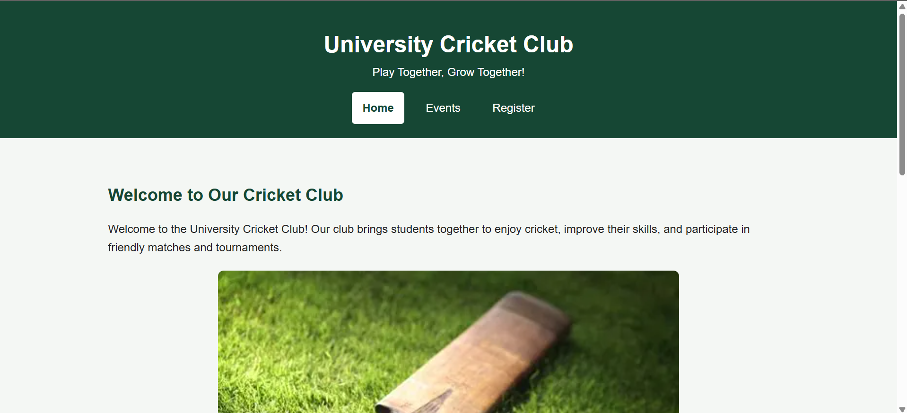

University Cricket Club 
This is a simple and responsive website developed using HTML5, CSS3 and JavaScript. It provides students with information about club the upcoming events and event registration.

Pages:
1. Home page
2. Event page
3. Register page 

To run the website locally:
1. Download the project repository to your computer
2. Open CricketClub folder in Visual Studio Code
3. Open index.html using live server extension
4. Use the navigation menu to visit the Home, Events and  Register pages

Live URL: https://minahilmasood208.github.io/cit331-assignment1-24l-0009/

